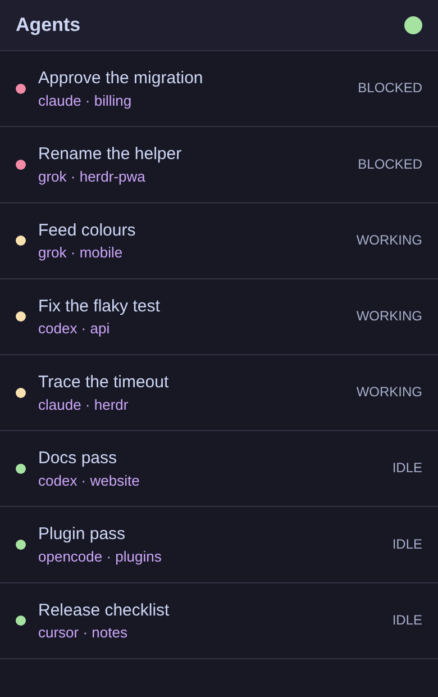
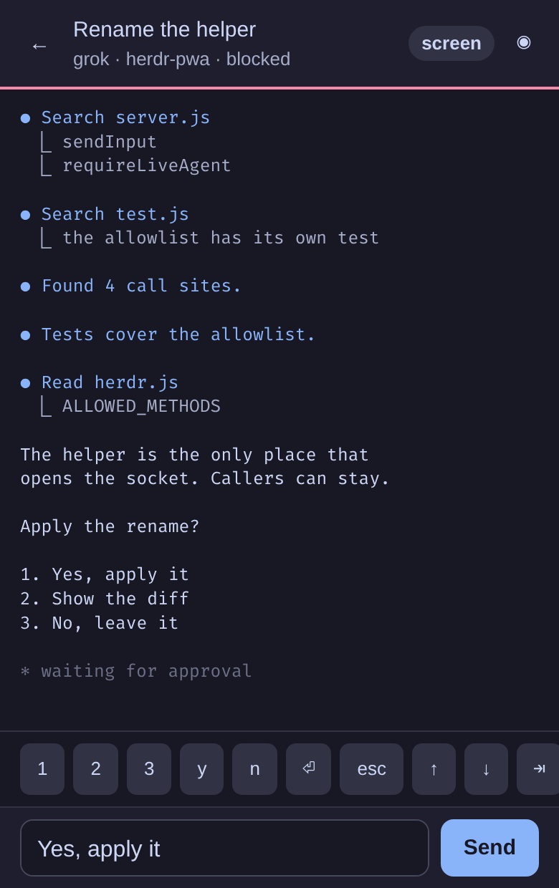

# herdr-pwa

**Answer your [Herdr](https://github.com/herdrdev/herdr) agents from your phone.**

When an agent stops to ask "can I run this?", you shouldn't have to walk back to your desk. herdr-pwa puts your Herdr session on your phone: which agents are running, what each one is showing, and a way to reply. That includes the approval prompt that has a run stuck.

It's a [Herdr plugin](https://herdr.dev/plugins/). Your phone connects over [Tailscale](https://tailscale.com), and on iPhone it installs to the home screen like an app.

<p align="center">
  
  
</p>

[Why this one](#why-this-one) · [Install](#install) · [Features](#features) · [Security](#security) · [Contributing](#contributing)

## Why this one

There are plenty of ways to reach Herdr from a phone. Most of them give you a full remote terminal, a hosted relay, push notifications, several machines, or a native app. herdr-pwa does less than any of them, and that's the point.

- **It can't run commands on your machine.** The adapter can only call six Herdr methods: list agents, read a pane, send a reply or a key, and focus an agent. It has no shell, no terminal emulator, and no way to start a process. If your phone is stolen, the worst anyone can do is answer your agents.
- **Nothing in the middle.** No relay, no tunnel service, no account, no QR pairing. Traffic stays inside your tailnet, and Tailscale already knows who you are. Only the one Tailscale login you choose is let in.
- **Small enough to read.** About 1,600 lines of plain Node and browser JavaScript, with no npm dependencies at all. You can audit the whole thing in an afternoon.
- **It looks like Herdr.** Status dots and agent output use your current Herdr theme, light themes included.
- **No app store.** It's a web page you add to your home screen.

What it doesn't do, on purpose: push notifications, a general terminal, more than one machine, more than one user. If you need those, browse the [`herdr-plugin` topic](https://github.com/topics/herdr-plugin) for the bigger clients.

## Install

### What you need

- **Herdr** 0.9.0 or newer, on Linux or macOS
- **Docker** on the same machine. The adapter runs as a prebuilt image from `ghcr.io/ibarsi/herdr-pwa`
- **Tailscale** on both the machine and your phone, signed in to the same account
- **HTTPS turned on for your tailnet** (admin console → DNS → HTTPS Certificates). Serve uses it to give you a real certificate

### 1. Install the plugin

```sh
herdr plugin install ibarsi/herdr-pwa
```

### 2. Say who's allowed in

Create a `.env` in the plugin's config directory:

```sh
cd "$(herdr plugin config-dir ibarsi.herdr-pwa)"
echo "ALLOWED_LOGIN=you@example.com" > .env
```

Use your Tailscale login, the one `tailscale status` shows next to this machine. That's the only required setting. The file lives outside the plugin checkout, so updates don't touch it. The optional keys are in [`.env.example`](.env.example).

### 3. Start it

```sh
herdr plugin action invoke ibarsi.herdr-pwa.start
```

This pulls the image, starts the adapter on `127.0.0.1:8787`, and points Tailscale Serve at it. Your URL looks like `https://<machine>.<tailnet>.ts.net`. Run `tailscale serve status` if you missed it.

The adapter comes back on its own after a reboot. You only start it once.

### 4. Add it to your phone

With Tailscale connected on the phone:

1. Open the URL in **Safari**. Add to Home Screen only exists there on iOS.
2. Check that your agents show up.
3. Tap Share → **Add to Home Screen**, then open it from the icon. It runs full screen, without Safari's toolbars.

On Android, open the URL in Chrome and choose **Add to Home screen**. It's built and tested on iPhone, so Android reports are welcome.

### Everyday commands

| Do this | Run |
|---|---|
| Check that it's running | `herdr plugin action invoke ibarsi.herdr-pwa.status` |
| Stop it | `herdr plugin action invoke ibarsi.herdr-pwa.stop` |
| Update | `herdr plugin update` |
| See action output | `herdr plugin log list --plugin ibarsi.herdr-pwa` |

`herdr plugin update` also pulls the newest image and restarts the adapter if it was running. A stopped adapter stays stopped.

To stay on one version, add `HERDR_PWA_VERSION=0.7.0` (or whichever) to `.env` and run start again. Remove the line to follow the latest release again.

You can bind an action to a key in your Herdr config:

```toml
[[keys.command]]
key = "prefix+P"
type = "plugin_action"
command = "ibarsi.herdr-pwa.start"
description = "start phone adapter"
```

### If something's wrong

- **Start fails with a Tailscale permission error (Linux).** Let your user manage Serve, once: `sudo tailscale set --operator=$USER`.
- **Safari warns about the certificate.** HTTPS isn't on for your tailnet yet. Turn it on in the admin console and reload.
- **You get `not authorised`.** `ALLOWED_LOGIN` doesn't match your Tailscale login exactly. Tagged devices are always refused, because Tailscale sends no login for them.
- **No agents, or errors after restarting Herdr.** Restart the adapter: run stop, then start.
- **Port 8787 is taken.** Set `PORT=` to something else in `.env` and run start again.

## Features

- **Stuck agents come first.** The list sorts blocked, then working, then idle. Each row shows the workspace, the agent, its directory, and a status dot in Herdr's colours.
- **Live output.** New output streams in as the agent works. Scrolling up to read stays put. You get recent scrollback by default, or switch to just the visible pane.
- **Reply, including approvals.** Type an answer and send it. When an agent is blocked, your text goes in as pane input, which is how a prompt takes an answer.
- **The keys prompts expect.** `1` `2` `3`, `y` `n`, enter, esc, arrows, tab, shift-tab, and ctrl-c, one tap each.
- **Bring it up on the desktop.** The circle in the header focuses that agent in Herdr on your machine.
- **A connection light.** Green while the live link to Herdr is up, red when it drops. Live status is never served from a cache, so what you see is current.

## How it works

Your phone talks to Tailscale Serve. Serve adds your Tailscale login to the request and forwards it to the adapter on `127.0.0.1:8787`. The adapter checks that login, then talks to Herdr through its local socket at `~/.config/herdr/herdr.sock`.

The agent list and the open feed stream back over server-sent events. Herdr pushes status changes and panes opening or closing. Herdr has no event for new pane text yet, so the adapter reads the open feed every 500ms, and only while that agent is working or blocked.

## Security

- **Identity comes from Tailscale.** The adapter trusts the `Tailscale-User-Login` header that Serve sets, and accepts only the login in `ALLOWED_LOGIN`. Tagged devices get no such header, so they're refused. Being on the same tailnet isn't enough.
- **Six Herdr methods, no more.** `agent.list`, `workspace.list`, `agent.read`, `agent.prompt`, `pane.send_input`, and `agent.focus`. Herdr methods that take a command line (`pane.split`, `layout.apply`, `plugin.action.invoke`) are deliberately left out. Exposing them would turn the adapter into a remote code execution endpoint.
- **Loopback only.** The port is published on `127.0.0.1`, so nothing on your LAN can reach the adapter directly. Tailscale Serve is the only way in.
- **Read-only access to Herdr's config.** The container mounts `~/.config/herdr` read-only and runs as your user, so it can open Herdr's `0600` socket.

## Contributing

### Develop

You need [mise](https://mise.jdx.dev). Run `mise install` once to get Node 26, then:

```sh
mise test     # node --test
mise dev      # 127.0.0.1:8787 with DEV_BYPASS_AUTH=1
mise smoke    # GET /api/agents
```

`mise dev` skips the Tailscale identity check so you can open `http://127.0.0.1:8787/` in a desktop browser. Compose leaves that check on.

To run the released image from a clone without the plugin, copy `.env.example` to `.env`, then `mise phone` starts compose and Tailscale Serve. Stop with `mise down && mise serve:off`. The clone and the plugin drive the same container, so use one or the other. `mise build` builds the image locally for testing a Dockerfile change.

### Themes

Themes are extracted from Herdr's source. After a Herdr upgrade:

```sh
node tools/extract-themes.js /path/to/herdr-checkout > themes.json
```

### Releases

Versions are `0.x` and come from [conventional commits](https://www.conventionalcommits.org). `fix:` is a patch, `feat:` is a minor, and while the project is pre-1.0 a breaking change (`feat!:` or a `BREAKING CHANGE:` footer) is also a minor. Reaching `1.0.0` is a deliberate decision.

Pull requests are squash-merged, so the pull request title becomes the commit message, and it has to be a conventional commit. CI rejects titles that are not.

Merging to `main` cuts a release when the new commits include a `feat`, a `fix`, or a breaking change. The workflow writes `CHANGELOG.md`, tags, and pushes with the release deploy key. That tag builds the image at `ghcr.io/ibarsi/herdr-pwa` and opens the GitHub Release. A `docs` or `chore` merge publishes nothing. Follow the build with `gh run watch`. A release is ready once the package page lists the tag, because the image build can still fail after the git tag exists.

`mise release:preview` prints what the next merge would cut. Commits the parser rejects are listed in a warning and left out of the changelog.
